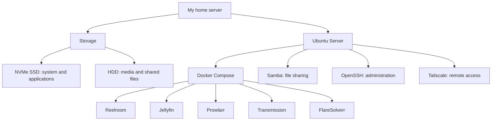

# My Homelab

This is my home server, which I use to run self-hosted services and learn Linux server administration. It combines everyday applications with a practical environment for exploring containers, storage, networking, and remote management.

## What I use it for

- Hosting a personal media library and streaming it with Jellyfin.
- Browsing media and managing requests through Reelroom.
- Managing downloads and connecting services through APIs.
- Sharing files between devices on my home network.
- Learning how to deploy and manage services on a Linux server.

## Hardware

| Component | Specification |
| --- | --- |
| Server | HP EliteDesk 705 G4 DM 35W |
| Processor | AMD PRO A10-9700E R7 |
| Memory | 7.2 GiB available to Linux |
| System storage | 256 GB NVMe SSD |
| Data storage | 1 TB HDD |
| Network | Gigabit Ethernet |
| Operating system | Ubuntu 24.04 LTS |

The NVMe SSD holds the operating system, Docker, and application configuration. The HDD stores media, downloads, and shared files.

## Docker containers

I use Docker Compose to manage five application containers.

| Container | Service | Purpose |
| --- | --- | --- |
| `reelroom` | Reelroom | A custom web application for browsing movies and TV shows, checking availability in Jellyfin, and submitting requests. It uses a Python backend and SQLite for request storage. |
| `jellyfin` | Jellyfin | Organizes my media library and provides playback across devices. |
| `prowlarr` | Prowlarr | Manages indexers and provides media search for the request workflow. |
| `transmission` | Transmission | Handles downloads and stores the downloaded files on the data drive. |
| `flaresolverr` | FlareSolverr | A browser-based helper for handling website challenges in indexer workflows. |

Reelroom connects catalogue metadata from TMDB with Jellyfin library information and Prowlarr search, bringing these services together in one interface.

## Server services

| Service | What I use it for |
| --- | --- |
| Docker and Docker Compose | Running application containers and managing their configuration and persistent data. |
| Samba | Sharing files stored on the server with other devices on my home network. |
| OpenSSH | Accessing the server from a terminal for administration. |
| Tailscale | Connecting my devices through a private network for remote access. |
| systemd | Managing host services and scheduled tasks. |

## Server overview

## What I am learning

This homelab helps me build practical skills in Linux administration, Docker Compose, persistent storage, file permissions, networking, and application integration. I use it to understand how services work together and gain experience managing a server over time.

## Future plans

My next steps are to refine the setup for multiple users, add backups to another disk, and expand the server with cloud storage and photo backup services. See the [roadmap](ROADMAP.md) for details.

## Inspiration

The documentation layout was inspired by [KevJimenez/HomelabProject-v.1](https://github.com/KevJimenez/HomelabProject-v.1).
